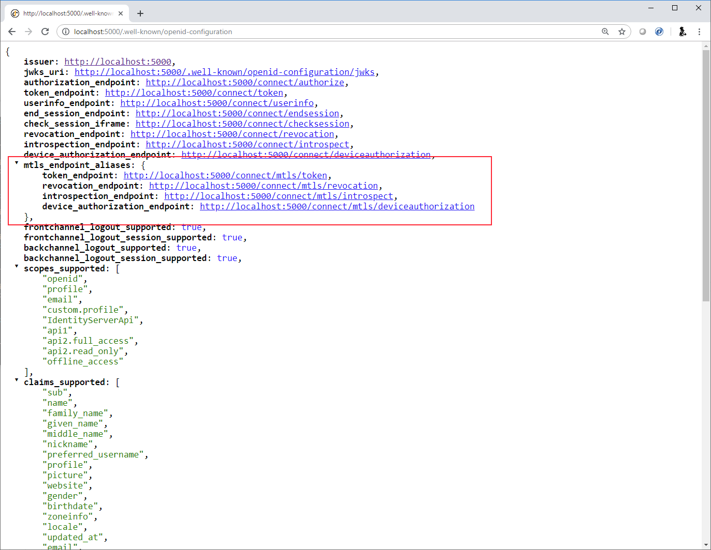
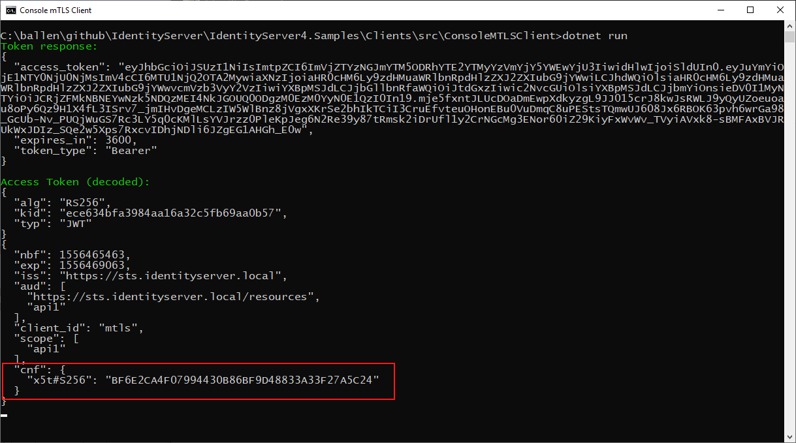

.. _refMutualTLS:
Mutual TLS
==========
Mutual TLS support in Open.IdentityServer allows for two features:

* Client authentication to Open.IdentityServer endpoints using a TLS X.509 client certificate
* Binding of access tokens to clients using a TLS X.509 client certificate

.. Note:: See the `"OAuth 2.0 Mutual-TLS Client Authentication and Certificate-Bound Access Tokens" <https://tools.ietf.org/html/rfc8705>`_ spec for more information

Setting up MTLS involves a couple of steps.

Server setup
^^^^^^^^^^^^
The hosting layer (Kestrel, IIS, a reverse proxy) must be configured to request a client certificate and make it available to ASP.NET Core.

.. Important:: The hosting layer should validate client certificates, as a first line of defence. Configure your server or reverse proxy to reject any client
    certificate that does not chain to a trusted CA, is expired, or has been revoked, **before** the request reaches Open.IdentityServer:

    * Kestrel: do not use ``AllowAnyClientCertificate()``. Validate the certificate chain against your trusted CAs in ``ClientCertificateValidation`` and enable revocation checking.
    * Reverse proxies (e.g. nginx): the proxy must validate the certificate (e.g. ``ssl_verify_client on``) and only forward certificates it has validated.
      Forwarding a certificate that has not been validated has the same effect as accepting any certificate.
    * Consider hosting the MTLS endpoints on a separate domain (``MutualTls.DomainName``) and not requesting client certificates on your main domain.

    Note that rejecting untrusted certificates in the hosting layer also rejects self-signed certificates. If you rely on those (e.g. thumbprint-based secrets),
    allow them in the hosting layer and restrict them with the certificate authentication handler's ``AllowedCertificateTypes``.

.. Warning:: Open.IdentityServer does not rely on the hosting layer alone. A client certificate is only accepted as a credential
    after the ASP.NET Core certificate authentication handler (see below) has authenticated it. This handler is **required** for MTLS client authentication
    and performs the chain, validity period and revocation checks. Validating in both places means a misconfiguration of one layer does not expose your clients.
    Never rely on the secret matching (name or thumbprint) as proof that the certificate is trusted.

Depending which server you are using, those steps are different. Consult documentation for the type of server you are using for guidance on setting up this.

.. Note:: `mkcert <https://github.com/FiloSottile/mkcert>`_ is a nice utility for creating certificates for development purposes.

ASP.NET Core setup
^^^^^^^^^^^^^^^^^^
Depending on the server setup, there are different ways how the ASP.NET Core host will receive the client certificate. While for IIS and pure Kestrel hosting, there are no additional steps, 
typically you have a reverse proxy in front of the application server. 

This means that in addition to the typical forwarded headers handling, you also need to process the header that contains the client certificate.
Add a call to ``app.UseCertificateForwarding();`` in the beginning of your middleware pipeline for that.

The exact format how proxies transmit the certificates is not standardized, that's why you need to register a callback to do the actual header parsing.
The Microsoft `docs <https://docs.microsoft.com/en-us/aspnet/core/security/authentication/certauth>`_ show how that would work for Azure Web Apps.

If you are using Nginx (which we found is the most flexible hosting option), you need to register the following service in ``ConfigureServices``

.. code-block:: csharp

    services.AddCertificateForwarding(options =>
    {
        // header name might be different, based on your nginx config
        options.CertificateHeader = "X-SSL-CERT";

        options.HeaderConverter = (headerValue) =>
        {
            X509Certificate2 clientCertificate = null;

            if(!string.IsNullOrWhiteSpace(headerValue))
            {
                var bytes = Encoding.UTF8.GetBytes(Uri.UnescapeDataString(headerValue));
                clientCertificate = new X509Certificate2(bytes);
            }

            return clientCertificate;
        };
    });

Once, the certificate has been loaded, you also need to setup the certificate authentication handler. This step is **required**: without it, clients cannot authenticate with a certificate.
Open.IdentityServer authenticates a client certificate with this handler on every endpoint that authenticates clients, and rejects the request if the handler does not accept the certificate.
In this scenario we want to support self-signed certificates, hence the ``CertificateType.All`` and no revocation checking.
These settings might be different in your environment. For production, prefer the defaults (``CertificateTypes.Chained`` with revocation checking enabled) unless you specifically need self-signed certificates.

Custom scheme name
~~~~~~~~~~~~~~~~~~
By default the handler is registered as ``Certificate``, which matches the default value of ``options.MutualTls.ClientCertificateAuthenticationScheme``.
If you change that option, you must register the certificate authentication handler under the same scheme name:

.. code-block:: csharp

    services.AddIdentityServer(options =>
    {
        options.MutualTls.Enabled = true;
        options.MutualTls.ClientCertificateAuthenticationScheme = "MyCertificateScheme";
    });

    services.AddAuthentication()
        .AddCertificate("MyCertificateScheme", options =>
        {
            options.AllowedCertificateTypes = CertificateTypes.Chained;
        });

.. Warning:: If no handler is registered under the configured scheme name, MTLS client authentication fails with an
    ``InvalidOperationException`` ("No authentication handler is registered for the scheme ..."). The scheme must also be a certificate authentication
    handler, since it reads the client certificate from the connection.

.. code-block:: csharp

    services.AddAuthentication()
        .AddCertificate(options =>
        {
            options.AllowedCertificateTypes = CertificateTypes.All;
            options.RevocationMode = X509RevocationMode.NoCheck;
        });

Open.IdentityServer setup
^^^^^^^^^^^^^^^^^^^^^^^^^
Next step is to enable MTLS in Open.IdentityServer. For that you need to specify the name of the certificate authentication handler you set-up in the last step (defaults to ``Certificate``),
and the MTLS hosting strategy. The handler named here must be registered (``AddCertificate``), otherwise MTLS client authentication fails.

In Open.IdentityServer, the mutual TLS endpoints, can be configured in three ways (assuming Open.IdentityServer is running on ``https://identityserver.com``:

* path-based - endpoints located beneath the path ``~/connect/mtls``, e.g. ``https://identityserver.com/connect/mtls/token``.
* sub-domain based - endpoints are on a sub-domain of the main server, e.g. ``https://mtls.identityserver.io/connect/token``.
* domain-based - endpoints are on a different domain, e.g. ``https://identityserver-mtls.io``.  

For example

.. code-block:: csharp

    var builder = services.AddIdentityServer(options =>
    {
        options.MutualTls.Enabled = true;
        options.MutualTls.ClientCertificateAuthenticationScheme = "Certificate";
        
        // uses sub-domain hosting
        options.MutualTls.DomainName = "mtls";
    });

Open.IdentityServer's discovery document reflects those endpoints:

Client authentication
^^^^^^^^^^^^^^^^^^^^^
Clients can use a X.509 client certificate as an authentication mechanism to endpoints in Open.IdentityServer.

For this you need to associate a client certificate with a client in Open.IdentityServer.
Use the :ref:`Open.IdentityServer builder <refStartup>` to add the services to DI which contain a default implementation to do that either thumbprint or common-name based

.. code-block:: csharp

    builder.AddMutualTlsSecretValidators();

.. Note:: The secret validators only match the certificate against the client's secret (name or thumbprint). They do not validate the certificate.
    The certificate authentication handler configured in ``MutualTls.ClientCertificateAuthenticationScheme`` must be registered and must accept the certificate first.
    Name-based secrets are only as trustworthy as that validation, because anyone can create a self-signed certificate with any subject name.
    If you allow self-signed certificates (``CertificateTypes.All`` or ``SelfSigned``), prefer thumbprint-based secrets.
Finally, for the :ref:`client configuration <refClient>` add to the ``ClientSecrets`` collection a secret type of either ``SecretTypes.X509CertificateName`` 
if you wish to authenticate the client from the certificate distinguished name or ``SecretTypes.X509CertificateThumbprint`` if you wish to authenticate the client by certificate thumbprint.

For example

.. code-block:: csharp

    new Client
    {
        ClientId = "mtls",
        AllowedGrantTypes = GrantTypes.ClientCredentials,
        AllowedScopes = { "api1" }
        ClientSecrets = 
        {
            // name based
            new Secret(@"CN=mtls.test, OU=ROO\ballen@roo, O=mkcert development certificate", "mtls.test")
            {
                Type = SecretTypes.X509CertificateName
            },
            // or thumbprint based
            //new Secret("bca0d040847f843c5ee0fa6eb494837470155868", "mtls.test")
            //{
            //    Type = SecretTypes.X509CertificateThumbprint
            //},
        },
    }

Using a client certificate to authenticate to Open.IdentityServer
~~~~~~~~~~~~~~~~~~~~~~~~~~~~~~~~~~~~~~~~~~~~~~~~~~~~~~~~~~~~~~~~~
When writing a client to connect to Open.IdentityServer, the ``SocketsHttpHandler`` (or ``HttpClientHandler`` if you are on older .NET Framework versions) 
class provides a convenient mechanism to add a client certificate to outgoing requests.

And then HTTP calls with the ``HttpClient`` will perform client certificate authentication at the TLS channel.

For example

.. code-block:: csharp

    static async Task<string> RequestTokenAsync()
    {
        var handler = new SocketsHttpHandler();
        var cert = new X509Certificate2("client.p12", "password");
        handler.SslOptions.ClientCertificates = new X509CertificateCollection { cert };

        var client = new HttpClient(handler);

        // Discover the MTLS token endpoint
        var discoResponse = await client.GetAsync($"{Constants.Authority}/.well-known/openid-configuration");
        discoResponse.EnsureSuccessStatusCode();

        var discoJson = JsonDocument.Parse(await discoResponse.Content.ReadAsStringAsync());
        var mtlsAliases = discoJson.RootElement.GetProperty("mtls_endpoint_aliases");
        var tokenEndpoint = mtlsAliases.GetProperty("token_endpoint").GetString();

        // Request token
        var tokenRequest = new FormUrlEncodedContent(new Dictionary<string, string>
        {
            ["grant_type"] = "client_credentials",
            ["client_id"] = "mtls",
            ["scope"] = "api1"
        });

        var response = await client.PostAsync(tokenEndpoint, tokenRequest);
        response.EnsureSuccessStatusCode();

        return await response.Content.ReadAsStringAsync();
    }

Sender-constrained access tokens
^^^^^^^^^^^^^^^^^^^^^^^^^^^^^^^^
Whenever a client authenticates to Open.IdentityServer using a client certificate, the thumbprint of that certificate will be embedded in the access token.

Clients can use a X.509 client certificate as a mechanism for sender-constrained access tokens when authenticating to APIs.
The use of these sender-constrained access tokens requires the client to use the same X.509 client certificate to authenticate to the API as the one used for Open.IdentityServer.

Confirmation claim
~~~~~~~~~~~~~~~~~~
When a client obtains an access token and has authenticated with mutual TLS, Open.IdentityServer issues a confirmation claim (or ``cnf``) in the access token.
This value is a hash of the thumbprint of the client certificate used to authenticate with Open.IdentityServer.

This value can be seen in this screen shot of a decoded access token:

The API will then use this value to ensure the client certificate being used at the API matches the confirmation value in the access token.

Validating and accepting a client certificate in APIs
~~~~~~~~~~~~~~~~~~~~~~~~~~~~~~~~~~~~~~~~~~~~~~~~~~~~~
As mentioned above for client authentication in Open.IdentityServer, in the API the web server is expected to perform the client certificate validation at the TLS layer.

Additionally, the API hosting application will need a mechanism to accept the client certificate in order to obtain the thumbprint to perform the confirmation claim validation.
Below is an example how an API in ASP.NET Core might be configured for both access tokens and client certificates

.. code-block:: csharp

    services.AddAuthentication("token")
        .AddIdentityServerAuthentication("token", options =>
        {
            options.Authority = "https://identityserver.com";
            options.ApiName = "api1";

        })
        .AddCertificate(options =>
        {
            options.AllowedCertificateTypes = CertificateTypes.All;
        });

Finally, a mechanism is needed that runs after the authentication middleware to authenticate the client certificate and compare the thumbprint to the ``cnf`` from the access token.

Below is a simple middleware that checks the claims

.. code-block:: csharp

    public class ConfirmationValidationMiddlewareOptions
    {
        public string CertificateSchemeName { get; set; } = CertificateAuthenticationDefaults.AuthenticationScheme;
        public string JwtBearerSchemeName { get; set; } = JwtBearerDefaults.AuthenticationScheme;
    }
    
    // this middleware validate the cnf claim (if present) against the thumbprint of the X.509 client certificate for the current client
    public class ConfirmationValidationMiddleware
    {
        private readonly RequestDelegate _next;
        private readonly ConfirmationValidationMiddlewareOptions _options;

        public ConfirmationValidationMiddleware(RequestDelegate next, ConfirmationValidationMiddlewareOptions options = null)
        {
            _next = next;
            _options = options ?? new ConfirmationValidationMiddlewareOptions();
        }

        public async Task Invoke(HttpContext ctx)
        {
            if (ctx.User.Identity.IsAuthenticated)
            {
                var cnfJson = ctx.User.FindFirst("cnf")?.Value;
                if (!String.IsNullOrWhiteSpace(cnfJson))
                {
                    var certResult = await ctx.AuthenticateAsync(_options.CertificateSchemeName);
                    if (!certResult.Succeeded)
                    {
                        await ctx.ChallengeAsync(_options.CertificateSchemeName);
                        return;
                    }

                    var certificate = await ctx.Connection.GetClientCertificateAsync();
                    var thumbprint = Base64UrlTextEncoder.Encode(certificate.GetCertHash(HashAlgorithmName.SHA256));

                    var cnf = JObject.Parse(cnfJson);
                    var sha256 = cnf.Value<string>("x5t#S256");

                    if (String.IsNullOrWhiteSpace(sha256) ||
                        !thumbprint.Equals(sha256, StringComparison.Ordinal))
                    {
                        await ctx.ChallengeAsync(_options.JwtBearerSchemeName);
                        return;
                    }
                }
            }

            await _next(ctx);
        }

Below is an example pipeline for an API

.. code-block:: csharp

    app.UseForwardedHeaders(new ForwardedHeadersOptions
        {
            ForwardedHeaders = ForwardedHeaders.XForwardedFor | ForwardedHeaders.XForwardedProto
        });
        
    app.UseCertificateForwarding();
    app.UseRouting();
    app.UseAuthentication();
    
    app.UseMiddleware<ConfirmationValidationMiddleware>(new ConfirmationValidationMiddlewareOptions
    {
        CertificateSchemeName = CertificateAuthenticationDefaults.AuthenticationScheme,
        JwtBearerSchemeName = "token"
    });

    app.UseAuthorization();
    
    app.UseEndpoints(endpoints =>
    {
        endpoints.MapControllers();
    });

Once the above middleware succeeds, then the caller has been authenticated with a sender-constrained access token.

Introspection and the confirmation claim
~~~~~~~~~~~~~~~~~~~~~~~~~~~~~~~~~~~~~~~~
When the access token is a JWT, then the confirmation claim is contained in the token as a claim.
When using reference tokens, the claims that the access token represents must be obtained via introspection.
The introspection endpoint in Open.IdentityServer will return a ``cnf`` claim for reference tokens obtained via mutual TLS.

Ephemeral client certificates
^^^^^^^^^^^^^^^^^^^^^^^^^^^^^
You can use the Open.IdentityServer MTLS support also to create sender-constrained access tokens without using the client certificate for client authentication.
This is useful for situations where you already have client secrets in place that you don't want to change, e.g. shared secrets, or better private key JWTs. 

Still, if a client certificate is present, the confirmation claim can be embedded in outgoing access tokens. And as long as the client is using the same client certificate to 
request the token and calling the API, this will give you the desired proof-of-possession properties.

For this enable the following setting in the options

.. code-block:: csharp

    var builder = services.AddIdentityServer(options =>
    {
        // other settings
        
        options.MutualTls.AlwaysEmitConfirmationClaim = true;
    });

Using an ephemeral certificate to request a token
~~~~~~~~~~~~~~~~~~~~~~~~~~~~~~~~~~~~~~~~~~~~~~~~~
In this scenario, the client uses *some* client secret (a shared secret in the below sample), but attaches an additional client certificate to the token request.
Since this certificate does not need to be associated with the client at the token services, it can be created on the fly

.. code-block:: csharp

    static X509Certificate2 CreateClientCertificate(string name)
    {
        X500DistinguishedName distinguishedName = new X500DistinguishedName($"CN={name}");

        using (RSA rsa = RSA.Create(2048))
        {
            var request = new CertificateRequest(distinguishedName, rsa, HashAlgorithmName.SHA256,RSASignaturePadding.Pkcs1);

            request.CertificateExtensions.Add(
                new X509KeyUsageExtension(X509KeyUsageFlags.DataEncipherment | X509KeyUsageFlags.KeyEncipherment | X509KeyUsageFlags.DigitalSignature , false));

            request.CertificateExtensions.Add(
                new X509EnhancedKeyUsageExtension(
                    new OidCollection { new Oid("1.3.6.1.5.5.7.3.2") }, false));

            return request.CreateSelfSigned(new DateTimeOffset(DateTime.UtcNow.AddDays(-1)), new DateTimeOffset(DateTime.UtcNow.AddDays(10)));
        }
    }

Then use this client certificate in addition to the already setup-up client secret

.. code-block:: csharp

    static async Task<TokenResponse> RequestTokenAsync()
    {
        var client = new HttpClient(GetHandler(ClientCertificate));

        var disco = await client.GetDiscoveryDocumentAsync("https://identityserver.local");
        if (disco.IsError) throw new Exception(disco.Error);

        var endpoint = disco
            .TryGetValue(OidcConstants.Discovery.MtlsEndpointAliases)
            .Value<string>(OidcConstants.Discovery.TokenEndpoint)
            .ToString();
        
        var response = await client.RequestClientCredentialsTokenAsync(new ClientCredentialsTokenRequest
        {
            Address = endpoint,

            ClientId = "client",
            ClientSecret = "secret",
            Scope = "api1"
        });

        if (response.IsError) throw new Exception(response.Error);
        return response;
    }

    static SocketsHttpHandler GetHandler(X509Certificate2 certificate)
    {
        var handler = new SocketsHttpHandler();
        handler.SslOptions.ClientCertificates = new X509CertificateCollection { certificate };

        return handler;
    }
